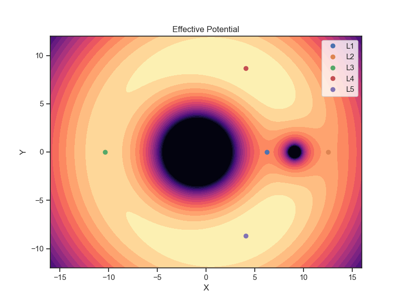
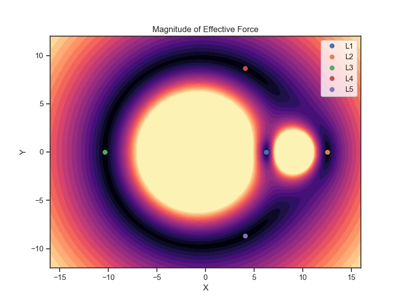
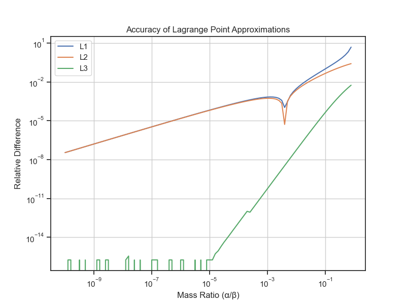
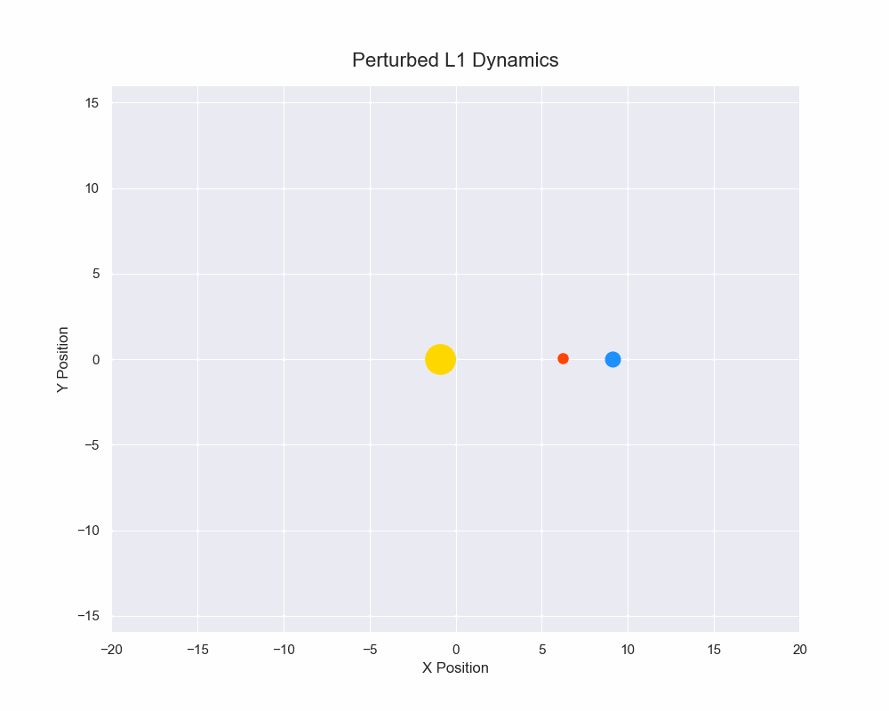
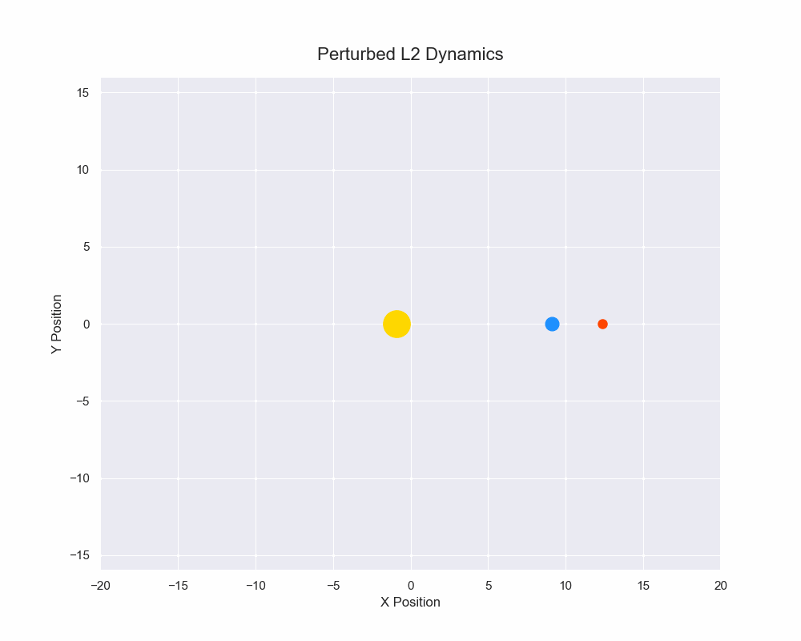
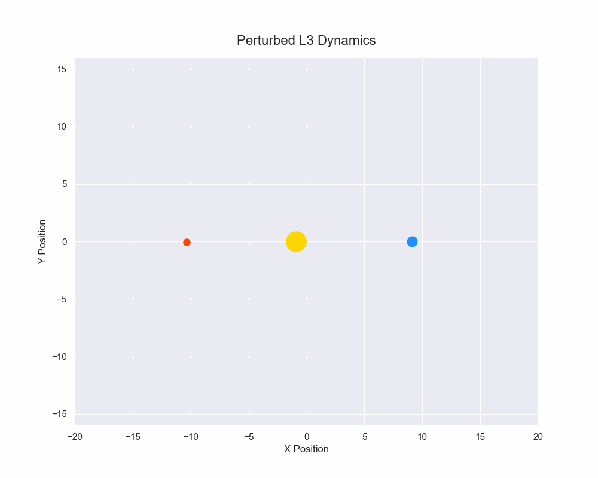
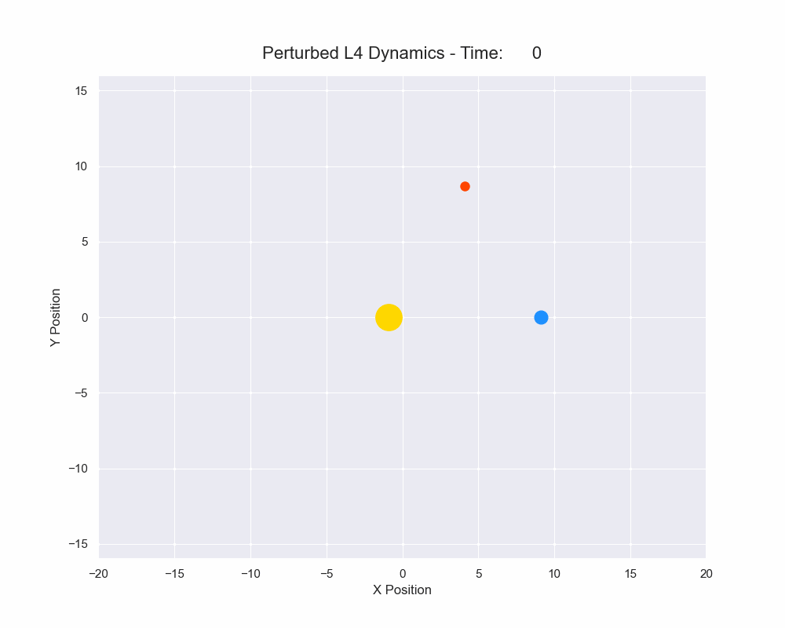
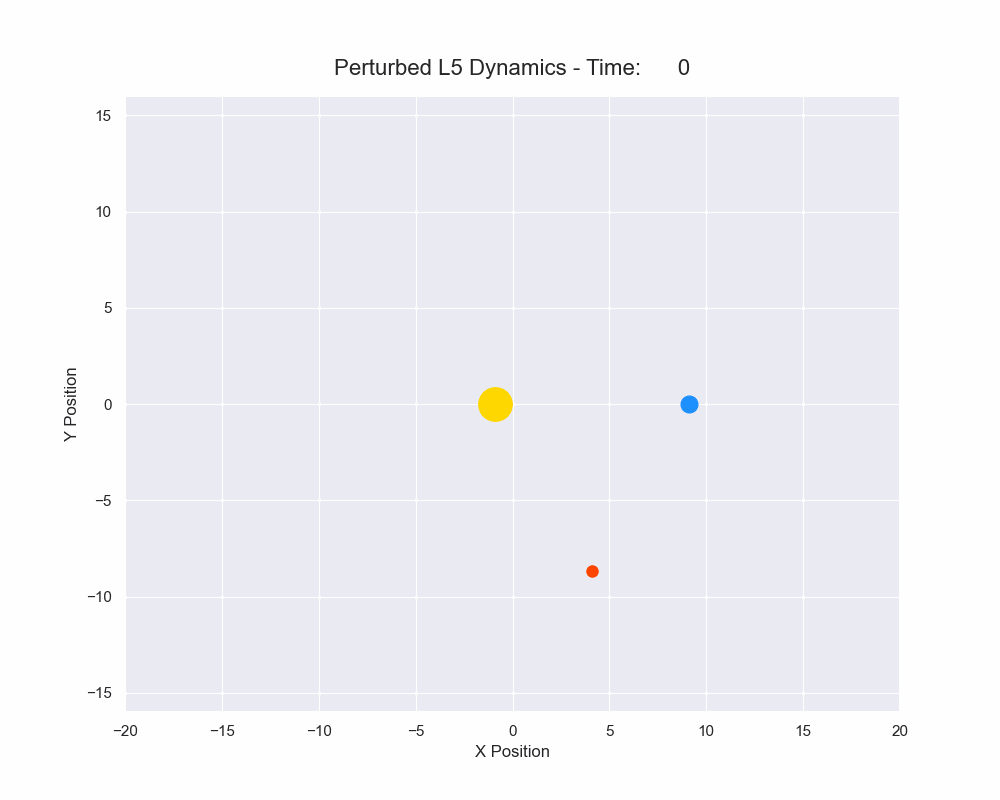

# Lagrange Point Analysis
This project contains an exploration of the restricted three body probelm wherein the motion of a small "massless test particle" is explored. Specifically, this project is focused on an exploration of the Lagrange points. 

The Lagrange points are points of equillibrium for small mass object under the graviational influence of two larger bodies. Under most conditions, the restricted three body problem is a chaotic system, but given particular starting conditions, it is possible for the smaller body to remain in an equillibrium point relative to the position of the two larger bodies.

## Project Overview
* Derive the position of the Lagrange points
* Asses the stability of these points
* Simulate dynamics of a small mass placed in each Lagrange point affected by a small perturbation

## Identification of the Lagrange Points
The procedure for finding the Lagrange points is fairly straightforward. The following will replicate the derivaiton of the points as conducted by Neil J. Cornish in [1].

We seek solutions which maintain a fixed distance between the three bodies. If $M_1$ and $M_2$ are the two larger masses, and $\vec{r_1}$ and $\vec{r_2}$ are the position vectors of the respective masses, then the total force exerted on a third mass $m$ at a position $\vec{r}$ will be

$$ 
\vec{F}
= -\frac{GM_1m}{|\vec{r}-\vec{r_1}|^3} (\vec{r}-\vec{r_1})
-\frac{GM_2m}{|\vec{r}-\vec{r_2}|^3} (\vec{r}-\vec{r_2})
$$

To find stationary solutions, we adopt a co-rotating frame in which $M_1$ and $M_2$ are held fixed. This frame has the origin fixed at the center of mass of the two larger bodies and has an angular frequency $\Omega$ given by Kepler's law:

$$
\Omega^2 R^3 = G(M_1 + M_2)
$$

The effective potential on $m$ is

$$
U_\Omega = U - 
\vec{v} \cdot (\vec{\Omega} \times \vec{r}) -
\frac{1}{2}(\vec{\Omega} \times \vec{r})\cdot(\vec{\Omega} \times \vec{r})
$$

With $U$ being the gravitational potential ($m$ can be set to unity without a loss of generality), 

$$
U = -G \left( \frac{M_1}{r_1}+\frac{M_2}{r_2} \right)
.$$

The velocity dependant terms in the potential do not effect the positions of the equillibrium points, but are key in understanding the stability of motion about the equillibrium points.

The potential $U_\Omega$ is plotted with $M_1=10$, $M_2=1$, $R=10$, $G=1$, and $\vec{v}=0$ in figure 1 with numerically calculated Lagrange points labled.

  
**Figure 1**

Taking the negative gradint of this potential, we get the force,

$$
\vec{F} = \Omega^2 \begin{pmatrix}
x-\frac{\beta(x+\alpha R)R^3}{((x+\alpha R)^2 + y^2)^{3/2}} - \frac{\alpha(x-\beta R)R^3}{((x-\beta R)^2 + y^2)^{3/2}} \\
y-\frac{\beta y R^3}{((x+\alpha R)^2 + y^2)^{3/2}} - \frac{\alpha y R^3}{((x-\beta R)^2 + y^2)^{3/2}}
\end{pmatrix}
$$

Where

$$ \alpha = \frac{M2}{M1+M2} $$
$$ \beta = \frac{M1}{M1+M2} $$

The force corresponding to the potential is plotted in figure 2.

  
**Figure 2**

Since the system is symmetric about the $x$-axis, the $y$ component of the force must vanish. To find the first three Lagrange points, we can set $y=0$ and use the change of coordinate $x=R(u+\beta)$. The desired 3 coordinates are the solutions to the three fifth-order equations

$$
u^2((1-s_1) + 3u + 3u^2 +u^3) = \alpha(s_0+2s_0 u + (1+ s_0 - s_1)u^2 +2u^3 +u^4)
$$

where $s_0=\text{sign}(u)$ and $s_1=\text{sign}(u+1)$. The cases that give L1, L2, and L3 have $(s_0, s_1)$ equal to (-1, 1), (1, 1), and (-1, -1) respectively. Each equation has only one real root to the quintic equation, which gives the Lagrange points. However, we are unable to find a general solution to these equations for arbitrary $\alpha$ so we take the approximation of $\alpha \ll 1$ which applies for relevant equations such as the Earth-Sun system $(\alpha \approx 10^{-6})$ and (less strongly) the Earth-Moon system $(\alpha \approx 10^{-2})$. To first order in $\alpha$ we find these first three Lagrange points to be positioned at:

$$
L1: \begin{pmatrix} R[1-(\frac{\alpha}{3})^{1/3}] \\ 0 \end{pmatrix}
$$
$$
L2: \begin{pmatrix} R[1+(\frac{\alpha}{3})^{1/3}] \\ 0 \end{pmatrix}
$$
$$
L3: \begin{pmatrix} -R[1+\frac{5}{12}\alpha] \\ 0 \end{pmatrix}
$$

The accuracy of these approximations depends on the mass ratio $\frac{\beta}{\alpha}$. The relative magnitude of the error is shown in figure 3,

  
**Figure 3**

To find the fourth and fifth Lagrange points, we must take a different approach. These points are found where the centrifugal force is balanced with the gravitional force from each of the bodies. To do this, we can resolve the force into parallel and perpecdicular components relative to $\vec{r}$. The perpendicular component yields

$$
F_{\Omega}^{\perp}=\alpha \beta y \Omega^2 R^3 \left(\frac{1}{((x-\beta R)^2 + y^2)^{3/2}}-\frac{1}{((x+\alpha R)^2 + y^2)^{3/2}}\right).
$$

Setting this to 0 for non-zero $y$ tells us that the distance between the test points and each mass must be equal. Using this fact, the parrallel component of the force becomes

$$
F_{Ω}^\parallel=\Omega^2\frac{x^2+y^2}{R}\left(\frac{1}{R^3}-\frac{1}{((x-\beta R)^2 + y^2)^{3/2}}\right),
$$

which, when set equal to 0 gives that the distance that the test points must be a distance R from each mass. This means that the location of $L4$ and $L5$ are given by the tip of an equillateral triangle of side length $R$ with the other two points being centered on the COM of the larger masses.

$$
L4: \begin{pmatrix} \left(\frac{R}{2} (\beta-\alpha)\right) \\ \frac{\sqrt{3}}{2}R \end{pmatrix}
$$
$$
L4: \begin{pmatrix} \left(\frac{R}{2} (\beta-\alpha)\right) \\ -\frac{\sqrt{3}}{2}R \end{pmatrix}
$$

Note that $L4$ and $L5$ are exact, not subject to the same approximation used to find the first three Lagrange points.

## Stability of the Lagrange Points
Using the REBOUND N-body code[2] (integrated using IAS15, a 15th order Gauss-Radu integrator [3]) and the same parameters used to generate figures 1-3, we can simulate what happends if we place a test mass at each of the Lagrange points, and enact a small randomized perturbation $<0.1$ on their x and y positions.

Figures 4-8 are example gifs showing motion of test particles located at each of the Lagrange points after a small perturbation in their position.

  
**Figure 4**

  
**Figure 5**

  
**Figure 6**

  
**Figure 7**

  
**Figure 8**

## Sources:
[1]: N.J Cornish, *The Lagrange Points*, https://science.nasa.gov/wp-content/uploads/2023/07/3322_lagrange.pdf

[2]: H. Rein and S.-F. Liu, *REBOUND: an open-source multi-purpose N-body code for collisional dynamics* A&A, 537 (2012) A128, https://doi.org/10.1051/0004-6361/201118085

[3]: H. Rein, D.S. Spiegel, *ias15: a fast, adaptive, high-order integrator for gravitational dynamics, accurate to machine precision over a billion orbits*, Monthly Notices of the Royal Astronomical Society, Volume 446, Issue 2, 11 January 2015, Pages 1424–1437, https://doi.org/10.1093/mnras/stu2164

[4]: Harris, C.R., Millman, K.J., van der Walt, S.J. et al. Array programming with NumPy. Nature 585, 357–362 (2020). DOI: 10.1038/s41586-020-2649-2.

[5]: P. Virtanen, et al., (2020) SciPy 1.0: Fundamental Algorithms for Scientific Computing in Python. Nature Methods, 17(3), 261-272. 10.1038/s41592-019-0686-2.

[6]: J. D. Hunter, "Matplotlib: A 2D Graphics Environment", Computing in Science & Engineering, vol. 9, no. 3, pp. 90-95, 2007

[7]: Waskom, M. L., (2021). seaborn: statistical data visualization. Journal of Open Source Software, 6(60), 3021, https://doi.org/10.21105/joss.03021