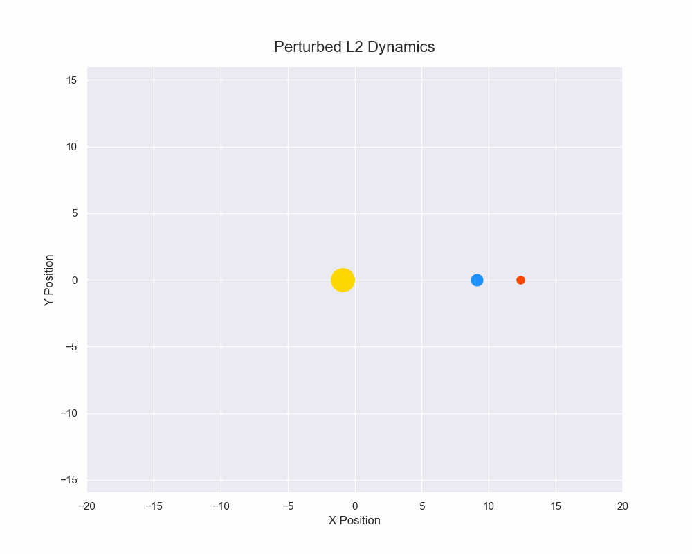
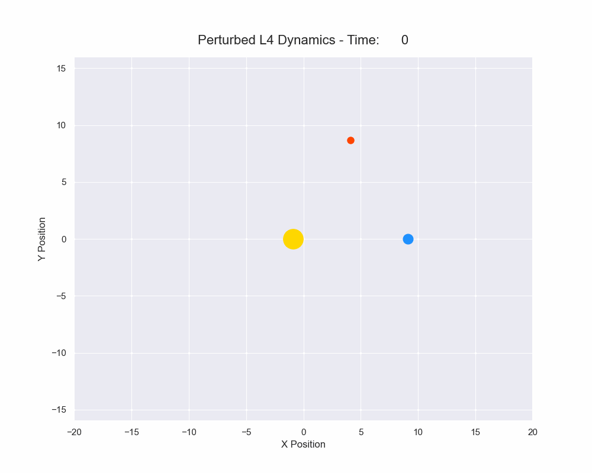
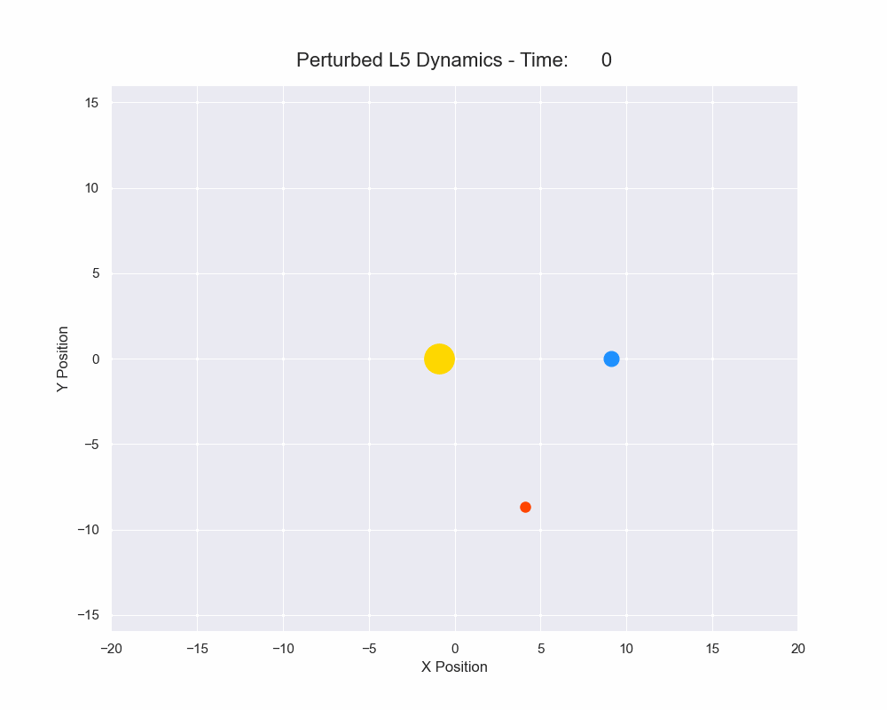
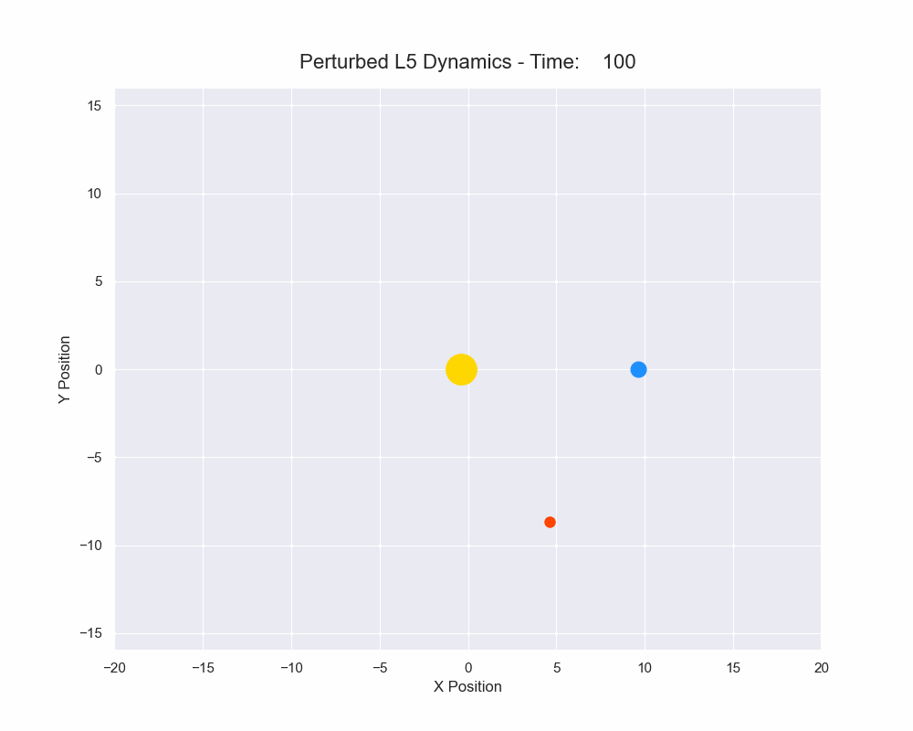

# Lagrange Point Analysis

An analytical and numerical exploration of the circular restricted three-body problem, focusing on the locations, linear stability, and perturbed $N$-body dynamics of the five Lagrange points ($L_1$–$L_5$).

> For the full formal writeup, see [`lagrange_points.pdf`](writeup/lagrange_points.pdf).

## Overview

In the circular restricted three-body problem, a massless test particle moves under the gravitational influence of two massive primary bodies ($M_1$ and $M_2$) orbiting their common center of mass. While generic trajectories are chaotic, five stationary equilibrium configurations—the **Lagrange points**—exist in the co-rotating reference frame where gravitational and centrifugal forces balance exactly [1].

Understanding these equilibria is central to astrodynamics and mission design. Despite the linear instability of the collinear points $L_1$ and $L_2$, spacecraft such as the **James Webb Space Telescope (JWST)** at Sun–Earth $L_2$ [2] and the **Solar and Heliospheric Observatory (SOHO)** at Sun–Earth $L_1$ [3] exploit bounded oscillatory eigenmodes to occupy halo and Lissajous orbits with minimal propellant. Meanwhile, above a critical mass ratio, the triangular points $L_4$ and $L_5$ (**Trojan points**) become linearly stable, enabling long-term natural trapping of minor bodies in systems like Sun–Earth and Earth–Moon [1].

**Project Goals:**
1. Derive the positions of all five Lagrange points analytically and benchmark small-mass-ratio approximations against exact numerical roots.
2. Determine the linear stability and characteristic $e$-folding timescales of each equilibrium point.
3. Validate the analytical stability boundaries through direct $N$-body simulations of perturbed test particles in `REBOUND`.

### Contents
- [Analytical Formulation](#analytical-formulation)
  - [Effective Potential & Equations of Motion](#effective-potential--equations-of-motion)
  - [Collinear Points ($L_1, L_2, L_3$)](#collinear-points-l_1-l_2-l_3)
  - [Triangular Points ($L_4, L_5$)](#triangular-points-l_4-l_5)
  - [Linear Stability Analysis](#linear-stability-analysis)
- [Numerical Methodology](#numerical-methodology)
- [Results & Discussion](#results--discussion)
  - [Effective Potential, Force Field & Approximation Error](#effective-potential-force-field--approximation-error)
  - [Perturbed $N$-Body Simulations](#perturbed-n-body-simulations)
- [References](#references)

---

## Analytical Formulation

### Effective Potential & Equations of Motion

Following Cornish [1], consider two primary bodies of masses $M_1$ and $M_2$ at positions $\vec{r}_1$ and $\vec{r}_2$, separated by a fixed distance $R$. The gravitational force on a test mass $m$ at position $\vec{r}$ is

$$
\vec{F} = -\frac{GM_1 m}{|\vec{r} - \vec{r}_1|^3}(\vec{r} - \vec{r}_1) - \frac{GM_2 m}{|\vec{r} - \vec{r}_2|^3}(\vec{r} - \vec{r}_2).
$$

Transforming into a co-rotating frame centered on the center of mass of $M_1$ and $M_2$ with constant angular frequency $\Omega$ given by Kepler's third law,

$$
\Omega^2 R^3 = G(M_1 + M_2),
$$

and setting $m = 1$ without loss of generality, the effective potential is

$$
U_\Omega = U - \vec{v} \cdot (\vec{\Omega} \times \vec{r}) - \frac{1}{2}(\vec{\Omega} \times \vec{r}) \cdot (\vec{\Omega} \times \vec{r}),
$$

where $\vec{v}$ is the test particle's velocity in the rotating frame and $U$ is the Newtonian gravitational potential:

$$
U = -G\left(\frac{M_1}{|\vec{r} - \vec{r}_1|} + \frac{M_2}{|\vec{r} - \vec{r}_2|}\right).
$$

The velocity-dependent Coriolis term $-\vec{v} \cdot (\vec{\Omega} \times \vec{r})$ vanishes for stationary equilibria ($\vec{v} = \vec{0}$), so it does not affect the positions of the Lagrange points, though it governs their dynamical stability.

Defining the dimensionless mass fractions

$$
\alpha = \frac{M_2}{M_1 + M_2}, \qquad \beta = \frac{M_1}{M_1 + M_2},
$$

places the primaries on the $x$-axis at $(-\alpha R, 0)$ and $(\beta R, 0)$. Taking the negative gradient of the static part of $U_\Omega$ yields the effective force in the orbital plane:

$$
\vec{F} = \Omega^2
\begin{pmatrix}
x - \dfrac{\beta(x + \alpha R)R^3}{\left((x + \alpha R)^2 + y^2\right)^{3/2}} - \dfrac{\alpha(x - \beta R)R^3}{\left((x - \beta R)^2 + y^2\right)^{3/2}} \\
y - \dfrac{\beta y R^3}{\left((x + \alpha R)^2 + y^2\right)^{3/2}} - \dfrac{\alpha y R^3}{\left((x - \beta R)^2 + y^2\right)^{3/2}}
\end{pmatrix}.
$$

---

### Collinear Points ($L_1, L_2, L_3$)

By symmetry about the $x$-axis, $F_y = 0$ along $y = 0$. Substituting $x = R(u + \beta)$ into $F_x = 0$ reduces the equilibrium condition to three quintic polynomial equations [1]:

$$
u^2\left((1 - s_1) + 3u + 3u^2 + u^3\right) = \alpha\left(s_0 + 2s_0 u + (1 + s_0 - s_1)u^2 + 2u^3 + u^4\right),
$$

where $s_0 = \operatorname{sign}(u)$ and $s_1 = \operatorname{sign}(u + 1)$. The sign pairs $(s_0, s_1) = (-1, 1)$, $(1, 1)$, and $(-1, -1)$ yield $L_1$, $L_2$, and $L_3$, respectively, each with a unique real root.

Because no general closed-form solution exists for arbitrary $\alpha$, we expand in the astrophysically relevant limit $\alpha \ll 1$ (e.g., $\alpha \approx 10^{-6}$ for Sun–Earth, $\alpha \approx 10^{-2}$ for Earth–Moon). To leading order in $\alpha$ [1]:

$$
L_1: \begin{pmatrix} R\left[1 - \left(\dfrac{\alpha}{3}\right)^{1/3}\right] \\ 0 \end{pmatrix}, \qquad
L_2: \begin{pmatrix} R\left[1 + \left(\dfrac{\alpha}{3}\right)^{1/3}\right] \\ 0 \end{pmatrix}, \qquad
L_3: \begin{pmatrix} -R\left[1 + \dfrac{5}{12}\alpha\right] \\ 0 \end{pmatrix}.
$$

---

### Triangular Points ($L_4, L_5$)

For off-axis equilibria ($y \neq 0$), resolving the effective force perpendicular and parallel to $\vec{r}$ gives [1]:

$$
F_\Omega^\perp = \alpha \beta y \Omega^2 R^3 \left(\frac{1}{\left((x - \beta R)^2 + y^2\right)^{3/2}} - \frac{1}{\left((x + \alpha R)^2 + y^2\right)^{3/2}}\right),
$$

$$
F_\Omega^\parallel = \Omega^2 \frac{x^2 + y^2}{R} \left(\frac{1}{R^3} - \frac{1}{\left((x - \beta R)^2 + y^2\right)^{3/2}}\right).
$$

Setting $F_\Omega^\perp = 0$ requires the test particle to be equidistant from $M_1$ and $M_2$; setting $F_\Omega^\parallel = 0$ fixes that distance to $R$. Thus $L_4$ and $L_5$ form equilateral triangles of side length $R$ with the two primaries:

$$
L_4: \begin{pmatrix} \dfrac{R}{2}(\beta - \alpha) \\ \dfrac{\sqrt{3}}{2}R \end{pmatrix}, \qquad
L_5: \begin{pmatrix} \dfrac{R}{2}(\beta - \alpha) \\ -\dfrac{\sqrt{3}}{2}R \end{pmatrix}.
$$

Unlike the collinear approximations, these coordinates are **exact for all mass ratios**.

---

### Linear Stability Analysis

Because $U_\Omega$ includes the velocity-dependent Coriolis term, static potential curvature alone cannot determine stability. Introducing small perturbations about an equilibrium point $(x_i, y_i)$,

$$
x = x_i + \delta x, \qquad y = y_i + \delta y, \qquad v_x = \delta v_x, \qquad v_y = \delta v_y,
$$

the linearized equations of motion for the state vector $\vec{\xi} = (\delta x, \delta y, \delta v_x, \delta v_y)^T$ are

$$
\frac{d}{dt}
\begin{pmatrix} \delta x \\ \delta y \\ \delta v_x \\ \delta v_y \end{pmatrix}
=
\begin{pmatrix}
0 & 0 & 1 & 0 \\
0 & 0 & 0 & 1 \\
-\dfrac{\partial^2 U_\Omega}{\partial x^2} & -\dfrac{\partial^2 U_\Omega}{\partial x \partial y} & 0 & 2\Omega \\
-\dfrac{\partial^2 U_\Omega}{\partial y \partial x} & -\dfrac{\partial^2 U_\Omega}{\partial y^2} & -2\Omega & 0
\end{pmatrix}
\begin{pmatrix} \delta x \\ \delta y \\ \delta v_x \\ \delta v_y \end{pmatrix},
$$

with all second partial derivatives evaluated at $(x_i, y_i)$. Writing the general solution as a superposition of eigenmodes $\vec{\xi}(t) = \sum_{k=1}^4 c_k e^{\lambda_k t}$ with $\lambda = \gamma + i\omega$, any eigenvalue with $\gamma = \operatorname{Re}(\lambda) > 0$ produces exponential instability characterized by the $e$-folding time

$$
\tau = \frac{1}{\gamma}.
$$

If all eigenvalues are purely imaginary ($\gamma = 0$), the equilibrium is linearly stable ($\tau \to \infty$).

#### Stability of $L_1$ and $L_2$
For $\alpha \ll 1$, both points are saddle points of the static potential:

$$
\frac{\partial^2 U_\Omega}{\partial x^2} = -9\Omega^2, \qquad
\frac{\partial^2 U_\Omega}{\partial y^2} = 3\Omega^2, \qquad
\frac{\partial^2 U_\Omega}{\partial x \partial y} = \frac{\partial^2 U_\Omega}{\partial y \partial x} = 0.
$$

The resulting eigenvalues are

$$
\lambda = \pm \Omega \sqrt{1 + 2\sqrt{7}}, \qquad \pm i\Omega \sqrt{2\sqrt{7} - 1}.
$$

The positive real root makes $L_1$ and $L_2$ linearly unstable, with a Sun–Earth $e$-folding time of $\tau \approx \frac{2}{5\Omega} \approx 23\text{ days}$ [1]. Missions like **JWST** ($L_2$) [2] and **SOHO** ($L_1$) [3] inject into halo or Lissajous orbits associated with the purely imaginary eigenvalue pair so that initial excitation along the unstable mode is nearly zero, then apply periodic station-keeping burns (every few weeks for JWST [2]; ~90 days for SOHO [3]) to counter solar radiation pressure and planetary perturbations.

#### Stability of $L_3$
$L_3$ is also a saddle point, with curvatures to first order in $\alpha$:

$$
\frac{\partial^2 U_\Omega}{\partial x^2} = -\frac{1}{4}(12 + 7\alpha)\Omega^2, \qquad
\frac{\partial^2 U_\Omega}{\partial y^2} = \frac{7\alpha\Omega^2}{8}, \qquad
\frac{\partial^2 U_\Omega}{\partial x \partial y} = \frac{\partial^2 U_\Omega}{\partial y \partial x} = 0.
$$

Its eigenvalues to first order in $\alpha$ are

$$
\lambda = \pm \frac{i}{8}(8 + 7\alpha)\Omega, \qquad \pm \frac{1}{2}\sqrt{\frac{21\alpha}{2}}\,\Omega.
$$

$L_3$ is linearly unstable, though it diverges much more slowly than $L_1$ and $L_2$, with a Sun–Earth $e$-folding time of $\tau \approx 56.7\text{ years}$ [1].

#### Stability of $L_4$ and $L_5$
At the triangular points, the curvatures are

$$
\frac{\partial^2 U_\Omega}{\partial x^2} = -\frac{3}{4}\Omega^2, \qquad
\frac{\partial^2 U_\Omega}{\partial y^2} = -\frac{9}{4}\Omega^2, \qquad
\frac{\partial^2 U_\Omega}{\partial x \partial y} = \frac{\partial^2 U_\Omega}{\partial y \partial x} = \pm \frac{3\sqrt{3}}{4}\kappa\Omega^2,
$$

where $\kappa = \frac{M_1 - M_2}{M_1 + M_2} = 1 - 2\alpha$. The eigenvalues are

$$
\lambda = \pm i\frac{\Omega}{2}\sqrt{2 \pm \sqrt{27\kappa^2 - 23}}.
$$

Linear stability requires all four eigenvalues to be purely imaginary, which holds if and only if $\kappa^2 > \frac{23}{27}$ and $\sqrt{27\kappa^2 - 23} \le 2$ [1]. The second inequality is always satisfied ($\kappa < 1$), while the first sets the critical mass-ratio threshold:

$$
\frac{M_1}{M_2} \ge \frac{1}{2}\left(25 + 3\sqrt{69}\right) \approx 24.96.
$$

When satisfied—as in both the Sun–Earth and Earth–Moon systems—the Coriolis force stabilizes motion about the potential maxima at $L_4$ and $L_5$, yielding stable Trojan orbits.

---

## Numerical Methodology

All numerical analysis and visualizations were implemented in Python using **NumPy** [6], **SciPy** [7], **Matplotlib** [8], **Seaborn** [9], and **REBOUND** [4].

* **Potential, Force Fields & Root Finding:** A baseline dimensionless system was defined with $G = 1$, $M_1 = 10$, $M_2 = 1$ ($M_1/M_2 = 10$), $R = 10$, and $\vec{v} = \vec{0}$. Fields $U_\Omega(x, y)$ and $|\vec{F}| = |\nabla U_\Omega|$ were evaluated over $x \in [-16, 16]$, $y \in [-12, 12]$, and exact equilibrium coordinates were found by solving $\vec{F}(x, y) = \vec{0}$ with `scipy.optimize.fsolve` [7].
* **Approximation Error Sweep:** To evaluate the $\alpha \ll 1$ collinear approximations, mass ratios were swept logarithmically across $\alpha/\beta \in [10^{-10}, 1)$, measuring the relative position error $\epsilon_i = \|\vec{r}_{i,\text{exact}} - \vec{r}_{i,\text{approx}}\| / \|\vec{r}_{i,\text{exact}}\|$.
* **$N$-Body Perturbation Simulations:** Dynamical stability was tested in **REBOUND** [4] using **IAS15**, a 15th-order adaptive Gauss–Radau integrator accurate to machine precision over long orbital timescales [5]. Massless test particles were initialized at each numerical Lagrange point with circular co-rotating velocity $(v_x, v_y) = (-\Omega y_i, \Omega x_i)$ plus a small randomized Gaussian position perturbation ($\le 10^{-4}$ in dimensionless units). Simulations were integrated over $20{,}000$ steps ($\Delta t = 0.1$) and rotated by $-\Omega \Delta t$ per step to visualize co-rotating trajectories at both $M_1/M_2 = 10$ (all five points) and $M_1/M_2 = 25$ ($L_4$ and $L_5$).

---

## Results & Discussion

### Effective Potential, Force Field & Approximation Error

For the baseline system ($G = 1$, $M_1 = 10$, $M_2 = 1$, $R = 10$), `fsolve` yields the exact equilibrium coordinates summarized below alongside their analytical stability properties:

| Point | $x$ | $y$ | Linear Stability | Sun–Earth $\tau$ |
| :--- | :---: | :---: | :--- | :--- |
| **$L_1$** | $6.266$ | $0.000$ | Unstable (saddle) | $\approx 23\text{ days}$ |
| **$L_2$** | $12.561$ | $0.000$ | Unstable (saddle) | $\approx 23\text{ days}$ |
| **$L_3$** | $-10.378$ | $0.000$ | Unstable (saddle) | $\approx 56.7\text{ years}$ |
| **$L_4$** | $4.091$ | $8.660$ | Stable if $M_1/M_2 \ge 24.96$ | Stable (Trojan) |
| **$L_5$** | $4.091$ | $-8.660$ | Stable if $M_1/M_2 \ge 24.96$ | Stable (Trojan) |

As expected, $L_1$, $L_2$, and $L_3$ lie at saddle points along the $x$-axis where $|\vec{F}| \to 0$, whereas $L_4$ and $L_5$ sit at local maxima of $U_\Omega$.

*Figure 1: Effective potential $U_\Omega(x, y)$ (clamped below at $-3$ for contrast) for $M_1 = 10$, $M_2 = 1$, $R = 10$, $G = 1$, and $\vec{v} = \vec{0}$, with numerically calculated Lagrange points labeled.*

*Figure 2: Magnitude of the co-rotating effective force $|\vec{F}| = |\nabla U_\Omega|$, showing vanishing force at all five Lagrange points.*

Comparing the first-order collinear approximations against `fsolve` roots shows smooth power-law convergence for $L_1$ and $L_2$ (falling below $10^{-3}$ relative error for $\alpha/\beta \lesssim 10^{-3}$, with a sign-crossing dip near $\alpha/\beta \approx 3 \times 10^{-3}$). The $L_3$ approximation converges even faster, reaching the floating-point floor ($\sim 10^{-16}$) for $\alpha/\beta \lesssim 10^{-5}$. Because the triangular coordinates are exact, $L_4$ and $L_5$ have zero analytical error across all mass ratios.

*Figure 3: Relative position error between the first-order collinear approximations and exact `fsolve` roots as a function of mass ratio $\alpha/\beta$.*

---

### Perturbed $N$-Body Simulations

#### Unstable Regime ($M_1 / M_2 = 10$)
Below the Trojan stability threshold ($M_1/M_2 < 24.96$), perturbed test particles at **all five** Lagrange points depart from equilibrium and enter chaotic trajectories in the co-rotating frame:

| Perturbed $L_1$ | Perturbed $L_2$ |
| :---: | :---: |
|  |  |

| Perturbed $L_3$ | Perturbed $L_4$ |
| :---: | :---: |
|  |  |

| Perturbed $L_5$ |
| :---: |
|  |

#### Stable Trojan Regime ($M_1 / M_2 = 25$)
Increasing the mass ratio to $M_1/M_2 = 25$—just above the analytical threshold of $\frac{1}{2}(25 + 3\sqrt{69}) \approx 24.96$—confirms the stabilizing effect of the Coriolis force. Perturbed test particles at $L_4$ and $L_5$ remain stably confined near equilibrium for the entire simulation, spanning **more than 50,000 orbits** of the primary bodies:

| Perturbed $L_4$ ($M_1/M_2 = 25$) | Perturbed $L_5$ ($M_1/M_2 = 25$) |
| :---: | :---: |
|  |  |

---

## References

1. N. J. Cornish, *The Lagrange Points*, NASA Technical Document, https://science.nasa.gov/wp-content/uploads/2023/07/3322_lagrange.pdf
2. J. Petersen, *L2 Station Keeping Maneuver Strategy for the James Webb Space Telescope*, Preprint, https://ntrs.nasa.gov/api/citations/20190028877/downloads/20190028877.pdf
3. C. E. Roberts, *Long Term Missions at the Sun-Earth Libration Point L1: ACE, SOHO, and WIND*, AAS 11-485, https://ntrs.nasa.gov/api/citations/20110022484/downloads/20110022484.pdf
4. H. Rein and S.-F. Liu, "REBOUND: an open-source multi-purpose N-body code for collisional dynamics," *Astronomy & Astrophysics*, vol. 537, A128, 2012, https://doi.org/10.1051/0004-6361/201118085
5. H. Rein and D. S. Spiegel, "IAS15: a fast, adaptive, high-order integrator for gravitational dynamics, accurate to machine precision over a billion orbits," *Monthly Notices of the Royal Astronomical Society*, vol. 446, no. 2, pp. 1424–1437, 2015, https://doi.org/10.1093/mnras/stu2164
6. C. R. Harris, K. J. Millman, S. J. van der Walt, et al., "Array programming with NumPy," *Nature*, vol. 585, pp. 357–362, 2020, https://doi.org/10.1038/s41586-020-2649-2
7. P. Virtanen, et al., "SciPy 1.0: Fundamental Algorithms for Scientific Computing in Python," *Nature Methods*, vol. 17, no. 3, pp. 261–272, 2020, https://doi.org/10.1038/s41592-019-0686-2
8. J. D. Hunter, "Matplotlib: A 2D Graphics Environment," *Computing in Science & Engineering*, vol. 9, no. 3, pp. 90–95, 2007.
9. M. L. Waskom, "seaborn: statistical data visualization," *Journal of Open Source Software*, vol. 6, no. 60, 3021, 2021, https://doi.org/10.21105/joss.03021